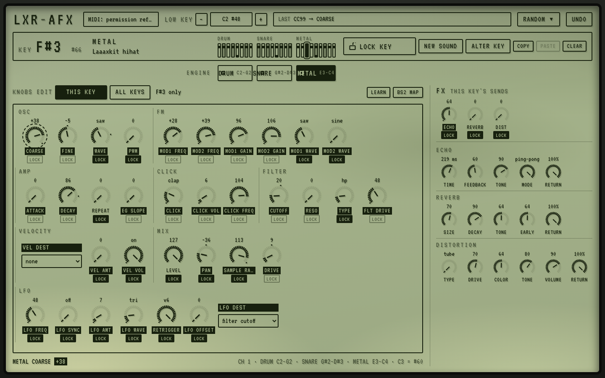

# LXR-AFX

An AFX-mode drum instrument in the browser: three sounds on one MIDI channel, every key its own sound.
**Play it: https://johnnyhawk02.github.io/lxr-afx/** (Chrome or Edge, for Web MIDI)



- **Three zones on MIDI channel 1**, laid out for the 25 keys of a Bass Station 2 at its default octave (lowest key MIDI
  48), one zone for each of the engine's three voice types, all three able to sound at once: **drum** on the lowest 8
  keys (48-55), **snare** on the next 8 (56-63), **metal** on the top 9 (64-72). Each zone's base key is its middle key
  (52, 60, 68). LOW KEY moves the whole layout by octaves; the sizes are `ZONE_SIZES` in `sound/schema.js`. Velocity is used.
- **Every key has its own sound.** A zone starts with a different kit sound of its type on every key (RESET KEYS in the
  RANDOM menu deals a fresh set); a key with nothing of its own plays the engine's base. (The auto-morph of earlier
  versions is gone: sound/morph.js is no longer used.)
- **Layout, top down: the key, then its engine, then its synth settings.** The key header shows the key you last played
  (or clicked on its strip of all 25 keys), its engine and what it plays, with **LOCK KEY** (L), **NEW SOUND** (K),
  **ALTER KEY** (A), **COPY** / **PASTE** (Cmd+C / Cmd+V, Ctrl on a PC; onto another engine it maps by control name) and
  **CLEAR**. A locked key turns the header black and veils the knobs. Everything that randomises a
  whole engine or all three (randomise, vary, alter, scatter, random kit, init, control locks) is in the **RANDOM** menu.
- **FX and master** (the right-hand column, full height): the two send effects from Elixir Desktop (the firmware's
  delay as an echo, and its reverb, both returned at full level), then the **master**: everything, dry and FX returns, through a
  distortion (drive, tone, mix), then a soft-knee compressor (threshold, ratio, attack, release, knee, makeup) with a
  gain-reduction meter, then the level. Each key's ECHO / REVERB sends are FX SENDS knobs with its synth knobs.
- **Note repeat**: each key's RATE knob (NOTE REPEAT: off, 1/64, 1/32, 1/16, 1/8; off by default) retriggers it while
  it's held, at the BPM in the top bar (120 by default), with the velocity it was played with.
- **Left column**: the key, its engine, and the synth knobs in four rows (osc, fm / amp, pitch, click / filter,
  velocity, mix / lfo, repeat), with the key's ECHO / REVERB sends and its big **LEVEL** knob in a column at the
  right. Pasting a key onto
  another engine labels it, e.g. "Brownie snare (as metal)".
- **Editor**: every parameter of the sound on one screen, as knobs (drag up/down, scroll or arrow keys; double-click
  resets; a notch outside the ring marks the base). By default an edit changes only the last key
  pressed (or the key picked in the key list); **ALL KEYS** sets a control on every key of the zone at once (locked keys
  stay). **CLEAR** puts a key back to the engine's base sound.
- **Knobs** (MIDI CC on channel 1), mapped for a Bass Station 2: they act on the last key played, like the editor (which
  follows the sound you play). Filter freq → cutoff, resonance → reso, overdrive → drive, amp attack/decay → attack/decay,
  mod env decay → pitch decay, mod env depth → pitch amount, distortion → FM amount, osc 1 coarse/fine → coarse/fine,
  LFO 1 speed / portamento → the key's echo / reverb sends, LFO 2 speed → its note repeat rate, osc 1 / osc 2 / sub levels → the
  drum / snare / metal levels. **LEARN** maps any knob to any control: press it, click the control, turn the knob.
- **Randomisers**: **SCATTER** deals a different real kit sound of the zone's type onto every key. **NEW SOUND** (or K, or a
  learned button) swaps just the key you last played for another kit sound, leaving the rest of the set alone.
- **LOCK KEY** (or L) freezes the key you last played: its whole sound and pitch are kept, and nothing (scatter,
  randomisers, ALL KEYS edits, reset, clear) changes it until you unlock it. Locked keys show a padlock on the key strip. **RANDOMISE** pulls in a variant from the built-in kits (a voice of the same type from a random kit,
  varied by the amount; locked controls stay), **VARY** and **ALTER** move the current sound, **RANDOM KIT** and
  **ALTER ALL** do all three sounds, with undo.

## Code

| Path | What it is |
|---|---|
| `engine/` | the LXR-02 firmware's drum engine in JavaScript, copied unchanged from [elixir-desktop](https://github.com/johnnyhawk02/elixir-desktop) |
| `sound/schema.js` | the seven sounds and each one's parameter schema (range, default, display, morph and randomiser rules) |
| `sound/morph.js` | the old key morph (no longer used by the page; kept with its tests) |
| `sound/instrument.js` | the engine as an instrument: `voices[i].play(note, velocity, params)` and `render(left, right)`, no UI |
| `sound/worklet.js` | the instrument in an AudioWorklet |
| `app/main.js`, `css/lcd.css` | the page |
| `kits/`, `sound/kits.js` | the built-in kits the randomisers draw from (`node tools/build-kits.mjs` rebuilds `kits.js`) |

No build step: the page loads the ES modules directly.

```sh
node test/morph.test.mjs                        # the morph and engine checks
python3 -m http.server 8123 & node test/shots.mjs   # screenshots at 1440x900 and 1280x800 (needs Playwright)
```

## Licence

GPL-3.0-only (see [LICENSE](LICENSE)), like Elixir and the firmware its engine is ported from
([erica-synths/lxr-desktop-app](https://github.com/erica-synths/lxr-desktop-app)). Unofficial: not made, approved or
endorsed by Erica Synths. "LXR" and "LXR-02" are trademarks of Erica Synths. The built-in kits include the Hrtl LXR-02
DLC kits, by Hrtl, distributed free by Erica Synths.
